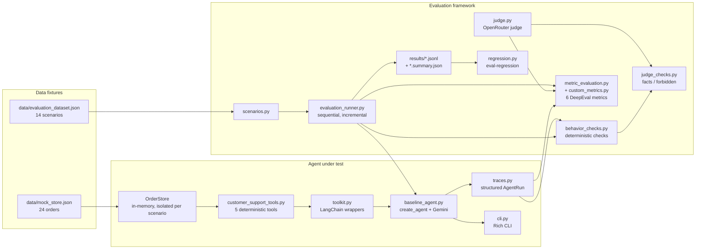

# AgentEval — AI Customer Support Agent Evaluation Framework

AgentEval is a repeatable evaluation framework for a **tool-using AI customer support agent**. It builds the agent, runs it against a fixed scenario dataset, and measures whether it *behaves* correctly — the tools it calls, the arguments it passes, the order of its actions, the grounding of its answer in real tool output, and its compliance with store policy — not merely whether its prose reads well.

The agent under test is a LangChain `create_agent` graph over a Google Gemini model, using five deterministic customer support tools backed by a mock electronics-store dataset.

## Project Overview

Tool-using LLM agents can produce a fluent, plausible answer while still behaving incorrectly:

- calling the wrong tool, or the right tool with wrong arguments;
- cancelling an order without first checking its status;
- approving a return outside the 30-day window;
- skipping a required escalation for a damaged or missing item;
- promising a refund, a callback, or a resolution time that no tool result supports.

Evaluating only the final response text misses all of these failures. AgentEval therefore evaluates the agent across complementary layers:

1. **Deterministic checks** over structured execution traces (tool selection, arguments, ordering, escalation, and the cancellation precondition).
2. **DeepEval standard Agent Evaluation metrics** — Tool Correctness, Argument Correctness, Task Completion, Step Efficiency.
3. **Custom DeepEval `GEval` metrics** — Tool Outcome Consistency and Business Policy Compliance.
4. **Regression testing** that compares a candidate run against a baseline run and fails when a previously passing behavior regresses, wired into GitHub Actions.

The result is a framework that reports both hard, reproducible pass/fail behavior checks and nuanced LLM-judged quality scores, with their limitations stated explicitly.

## Key Features

- **Agent built with LangChain `create_agent` + Google Gemini** (`src/agent/baseline_agent.py`), using the modern `create_agent` API (not the deprecated `AgentExecutor`).
- **Tool calling and a mock support environment**: five deterministic tools over a 24-order mock store — `get_order_status`, `get_order_details`, `check_refund_eligibility`, `cancel_order`, `escalate_to_human`.
- **DeepEval standard agent metrics**: Tool Correctness, Argument Correctness, Task Completion, Step Efficiency — evaluated over the agent's called tools and its structured execution trace.
- **Custom `GEval` metrics**: Tool Outcome Consistency (final-answer claims must be supported by tool results) and Business Policy Compliance (answer must comply with store policy text).
- **Deterministic checks** for expected tool calls (presence and order), tool arguments, escalation expectations, the cancellation precondition, and — via the LLM judge — `expected_facts` and `forbidden_behaviors`.
- **Baseline vs improved evaluation**: runs are labeled (`--label`) and compared (`eval-regression`) to measure whether a change actually improved behavior.
- **Regression testing and GitHub Actions**: an offline CI workflow plus a separate manual live-evaluation workflow that gates on regressions.
- **LangSmith tracing** (optional): agent runs are traced to a single project and tagged/metadata-labeled per experiment, including `scenario_id` and `scenario_category`.

## Architecture

Agent execution, evaluation, and terminal presentation are deliberately separated. The agent never contains evaluation logic or scenario-specific branching, and the evaluation code never executes the tools directly.



**Evaluation flow (per scenario, sequentially):**

1. `scenarios.py` loads and validates `data/evaluation_dataset.json` (read-only; scenario content is never hardcoded into tools or prompts).
2. The runner builds a fresh agent per scenario through `create_baseline_agent(...)` with an isolated `OrderStore` and a fresh `EscalationRegistry`, plus a fixed `reference_date` — so cancellation/escalation state cannot leak between scenarios.
3. The agent runs, producing a structured `AgentRun` trace (ordered `ToolCallRecord`s paired with their results).
4. Deterministic checks run over the trace; judge checks for `expected_facts`/`forbidden_behaviors` run against the shared OpenRouter judge.
5. Six DeepEval metrics run over the answer, the called tools, and the trace.
6. Each result is appended immediately as one JSONL line; a summary file is written at the end.
7. `regression.py` compares a candidate run against a baseline run and reports regressions, separate metric errors, and new failures.

Component boundaries (from `docs/ARCHITECTURE.md` and the code): agent execution stays independent of evaluation logic; terminal presentation stays independent of agent decisions; tool functions stay deterministic and free of LLM/network calls; structured traces are preserved rather than collapsed into logs.

## Evaluation Strategy

### Deterministic checks vs LLM-as-a-judge

| Aspect | Deterministic checks | LLM-as-a-judge |
| --- | --- | --- |
| Input | Scenario + structured trace | Scenario, trace, final answer, rubric |
| Output | Pass/fail with exact mismatches | Score + explanation |
| Strength | Reproducible, cheap, precise for tool behavior | Handles nuance, groundedness, policy reasoning |
| Weakness | Brittle if expectations are over-specified | Sensitive to model, prompt, and sampling |
| Used here for | Tool calls, arguments, sequence, escalation, cancellation rule | Answer quality, grounding, policy compliance, facts/forbidden behaviors |

**Why both are needed.** Deterministic checks provide a hard, reproducible floor for tool behavior: they catch a wrong tool, a bad order ID, a `cancel_order` without a preceding `get_order_status` returning `processing`, or a missing escalation. But they cannot judge whether a refusal was explained well, whether a claim is grounded in tool output, or whether an answer complies with nuanced policy. LLM-judge metrics cover those qualities. Judge scores are treated as **evidence, not ground truth**, and are reported alongside their limitations; where a judge disagrees with the trace on factual tool behavior, the trace wins.

### Separate judge model

The judge is deliberately **independent of the agent model** (`src/agent/judge.py`, `src/agent/config.py`):

- **Agent** — Google Gemini via Google AI Studio, configured by `AgentSettings` (`GOOGLE_API_KEY`, `AGENT_MODEL`, optional `AGENT_TEMPERATURE`).
- **Judge** — a Groq model accessed through OpenRouter, wrapped as a DeepEval `DeepEvalBaseLLM` (`OpenRouterJudge`) using `langchain-openai` and `JudgeSettings` (`OPENROUTER_API_KEY`, `OPENROUTER_BASE_URL`, `JUDGE_MODEL`).

Agent and judge settings are loaded by separate functions, so building the agent never requires judge credentials and vice versa. Secrets are stored as Pydantic `SecretStr` so they are masked in logs and `repr`.

The standard metrics use policy-aware prompt templates (`custom_metrics.py`) so that:

- **Task Completion** counts a policy-compliant resolution (a correct refusal, a required escalation, asking for a missing order ID, or a clear explanation) as complete, and takes the task deterministically from the customer message rather than LLM-extracting it.
- **Step Efficiency** treats required pre-checks and required terminal actions (e.g. escalation) as efficient.
- **Argument Correctness** applies cancellation policy (a status lookup is valid even when the order cannot be cancelled).

All metrics use a `0.5` threshold. A judge/API failure is recorded as a metric `error` (or a check `error`) and never counted as a pass.

### How results are collected and compared

- Results are stored incrementally in `results/<label>_<timestamp>_<id>.jsonl` (one JSON object per scenario) with a matching `.summary.json` (totals, pass/fail/error counts, per-category totals).
- Each scenario record contains: scenario id/category, customer message, `agent_model`, final `answer`, actual `tool_calls` (name, arguments, result, error), deterministic `checks`, DeepEval `metrics` (name, score, success, reason, threshold, error), execution `status`, `error`, and `duration_ms`.
- `eval-regression` compares a candidate run against a baseline: a baseline pass that becomes a candidate fail/error/missing record is a regression, as is a metric-score drop greater than a configurable tolerance between two passing results. Metric errors are reported separately and never counted as passes.

## Baseline vs Improved Results

| Run | Scenarios | Checks passed | Checks failed | Check errors | Metrics passed | Metrics failed | Metric errors |
| --- | --- | --- | --- | --- | --- | --- | --- |
| Baseline — `baseline_20261126T132600_cf9726` | 14 | 83 | 1 | 0 | 72 | 12 | 0 |
| Improved — `improvements_20261127T082918_e85922` | 14 | 75 | 8 | 1 | 80 | 4 | 0 |

**Failed metrics fell from 12 to 4 — a ~67% reduction in the raw failed-metric count.** The improved run also recorded **0 metric errors**.

The change is not uniform across layers: deterministic check failures rose from 1 to 8 (plus 1 judge error), and because the dataset changed between the two runs their failure sets are not directly comparable scenario-by-scenario. Some baseline failures were resolved, but others are new or shifted to different checks and metrics — for example a new deterministic gap on `escalation_001` (missing an expected `get_order_status` call) and a new `order_details_001` Argument Correctness failure. These are raw counts, not a controlled before/after comparison, and are reported honestly rather than as an unconditional improvement.

### Caveat: dataset changed during development

The evaluation dataset (`data/evaluation_dataset.json`) was modified during development, so the baseline and improved results are **not a perfectly controlled comparison** — the scenarios were not byte-identical across the two runs. The 12→4 change is a raw-count change under the documented conditions, **not** proof of a controlled improvement, that every scenario passes, or that every metric improved. A rigorous comparison requires an identical dataset and recorded configuration for both runs (see `docs/EVALUATION_STRATEGY.md`).

### Targeted run after policy changes

A targeted 3-scenario run after the latest policy changes passed **3/3 scenarios, 18/18 checks, and 18/18 metrics**.

## Tech Stack

Derived from `pyproject.toml`, `.python-version`, and the workflows. Version values are the minimum constraints declared in `pyproject.toml`.

| Area | Technology | Declared constraint |
| --- | --- | --- |
| Language | Python | `>=3.13` (`.python-version` = `3.13`) |
| Environment | uv, `uv.lock` | — |
| Data contracts | Pydantic v2 | `pydantic>=2.14.4` |
| Agent framework | LangChain | `langchain>=1.5.2` |
| Agent model | Google Gemini (`langchain-google-genai`) | `langchain-google-genai>=4.5.2` |
| Judge client | OpenRouter via `langchain-openai` | `langchain-openai>=1.8.5` |
| Tracing | LangSmith | `langsmith>=0.16.2` |
| CLI | Rich | `rich>=13.6,<15` |
| Config | python-dotenv | `python-dotenv>=1.2.4` |
| Evaluation | DeepEval | `deepeval>=4` |
| Tests / lint (dev) | pytest, Ruff | `pytest>=9.2.0`, `ruff>=0.17` |
| Build backend | Hatchling | — |
| CI/CD | GitHub Actions | checkout `v5`, setup-python `v6`, `astral-sh/setup-uv` `v7`, upload-artifact `v7` |

`rich` is pinned `<15` because DeepEval 4.x requires it.

## Project Structure

```text
.
├── .github/workflows/
│   ├── ci.yml                          # lint + offline unit tests on push / PR to main
│   └── llm-evaluation.yml              # manual live evaluation + regression gate
├── data/
│   ├── mock_store.json                 # 24 orders (fixed fixture)
│   └── evaluation_dataset.json         # 14 scenarios across 5 categories
├── docs/
│   ├── PROJECT_CONTEXT.md
│   ├── ARCHITECTURE.md
│   ├── EVALUATION_STRATEGY.md
│   └── DEVELOPMENT_STATUS.md
├── results/                            # run outputs: <label>_<run_id>.jsonl + .summary.json
├── src/agent/
│   ├── baseline_agent.py               # create_agent + Gemini, structured AgentRun
│   ├── behavior_checks.py              # deterministic checks
│   ├── cli.py                          # Rich terminal interface
│   ├── config.py                       # agent / judge / LangSmith settings
│   ├── custom_metrics.py               # GEval metrics + policy-aware prompt templates
│   ├── evaluation_runner.py            # sequential runner, resume, rerun, summary
│   ├── judge.py                        # OpenRouter-backed DeepEval judge
│   ├── judge_checks.py                 # expected_facts / forbidden_behaviors judging
│   ├── metric_evaluation.py            # DeepEval metric wiring
│   ├── regression.py                   # baseline-vs-candidate comparison
│   ├── scenarios.py                    # dataset loader (read-only)
│   ├── toolkit.py                      # LangChain tool wrappers
│   ├── traces.py                       # ToolCallRecord / AgentRun / AgentEvent
│   └── tools/
│       ├── models.py                   # Pydantic data + result models
│       ├── store.py                    # OrderStore (in-memory)
│       └── customer_support_tools.py   # five deterministic tools + EscalationRegistry
├── tests/                              # pytest suite (offline; models and metrics mocked)
├── .env.example
├── .python-version
├── AGENTS.md
├── pyproject.toml
└── uv.lock
```

## Setup

### Prerequisites

- Python 3.13
- [uv](https://docs.astral.sh/uv/) for environment and dependency management
- A Google AI Studio API key (to run the agent)
- An OpenRouter API key and a judge model (to run DeepEval metrics)
- Optional: a LangSmith API key (for tracing)

### Installation

```bash
uv sync
```

`uv sync` creates the environment from `uv.lock` and installs the project, including the console scripts.

### Environment variables

Copy the example file and fill in your own values. **Never commit real keys.**

```bash
cp .env.example .env
```

```dotenv
# Agent (Google Gemini via Google AI Studio)
GOOGLE_API_KEY=your_google_api_key
AGENT_MODEL=your_gemini_model
AGENT_TEMPERATURE=0

# Judge (Groq model accessed through OpenRouter)
OPENROUTER_API_KEY=your_openrouter_api_key
OPENROUTER_BASE_URL=https://openrouter.ai/api/v1
JUDGE_MODEL=your_groq_model

# Tracing (LangSmith)
LANGSMITH_TRACING=true
LANGSMITH_API_KEY=your_langsmith_api_key
LANGSMITH_PROJECT=agenteval
```

- The agent requires `GOOGLE_API_KEY` and `AGENT_MODEL`; `AGENT_TEMPERATURE` defaults to `0`.
- Metrics require `OPENROUTER_API_KEY`, `JUDGE_MODEL`, and optionally `OPENROUTER_BASE_URL` (defaults to `https://openrouter.ai/api/v1`).
- LangSmith tracing is optional; `LANGSMITH_PROJECT` defaults to `agenteval`.

`.env` is git-ignored. Secrets are held as Pydantic `SecretStr` and are masked.

## Running the Project

All commands are run from the repository root.

### Run the agent

```bash
# Single message, then exit
uv run agent-cli "Can you tell me the current status of order #1042?"

# Interactive session (type 'exit' or Ctrl-D to quit)
uv run agent-cli

# Fix the refund reference date for reproducible runs
uv run agent-cli --reference-date 2026-11-24 "..."
```

### Run tests and lint

```bash
uv run pytest          # full offline unit test suite
uv run pytest -q       # quiet
uv run ruff check .    # lint (as used in CI)
```

The unit tests mock the agent model and the DeepEval metrics, make no API calls, and never mutate the real data files.

### Run an evaluation

```bash
# Full run with metrics, labeled (label is arbitrary)
uv run eval-runner --label baseline

# Deterministic checks only (no OpenRouter judge, no metrics)
uv run eval-runner --label baseline --no-metrics

# Run only the first N scenarios
uv run eval-runner --label baseline --limit 5

# Override paths, reference date, or per-scenario timeout
uv run eval-runner --dataset data/evaluation_dataset.json --results-dir results \
  --reference-date 2026-11-24 --timeout 60
```

`eval-runner` supports:

- `--label` (default `baseline`), `--dataset`, `--results-dir`;
- `--reference-date YYYY-MM-DD` (default `2026-11-24`);
- `--limit N` (first N scenarios), `--timeout SECONDS` (default 60);
- `--no-metrics` (deterministic checks only).

Results are written to `results/<label>_<run_id>.jsonl` with a matching `.summary.json`, and each scenario is appended immediately so an interrupted run keeps completed work.

### Resume or rerun a run

```bash
# Resume an interrupted run: completed scenarios are skipped, errored ones retried
uv run eval-runner --resume results/<label>_<run_id>.jsonl

# Rerun a single scenario from an existing results file (replaces its record in place)
uv run eval-runner --resume results/<label>_<run_id>.jsonl --scenario-id <scenario_id>
```

`--scenario-id` requires `--resume`. The scenario must exist in the dataset and already have a record in the results file. Resume and rerun preserve the original label and run ID and refresh the summary.

### Regression comparison

```bash
uv run eval-regression \
  --baseline results/baseline_20261126T132600_cf9726.jsonl \
  --candidate results/improvements_20261127T082918_e85922.jsonl \
  --score-tolerance 0.1
```

`--baseline` and `--candidate` each accept a JSONL file or a directory (the newest `.jsonl` is used). The command exits non-zero when a regression is detected. A JSON report is written next to the candidate (or to `--report PATH`). Metric errors are reported separately and never treated as passes.

## CI/CD

### Regular CI — `.github/workflows/ci.yml`

Runs on every push and on pull requests to `main`.

- `ubuntu-latest`, Python from `.python-version`, uv installed with the `uv.lock` dependency cache;
- `uv sync --frozen`;
- `uv run ruff check .`;
- `uv run pytest`.

This workflow is fully offline: it runs lint and the mocked unit tests and calls no external APIs.

### Manual LLM evaluation — `.github/workflows/llm-evaluation.yml`

Triggered manually via `workflow_dispatch` with two inputs:

- `baseline` — baseline results JSONL file or directory (default `results/baseline_20261126T132600_cf9726.jsonl`);
- `score_tolerance` — allowed drop between two passing metric scores before it counts as a regression (default `0.1`).

Behavior:

- environment: `AGENT_MODEL=gemini-3.5-flash-lite`, `JUDGE_MODEL=openai/gpt-oss-20b`;
- runs the live evaluation: `uv run eval-runner --label llm-eval --results-dir results-llm-eval`;
- compares against the baseline: `uv run eval-regression --baseline "$BASELINE" --candidate results-llm-eval --score-tolerance "$SCORE_TOLERANCE"`;
- uploads `results-llm-eval/` as a build artifact (kept 14 days), even on failure;
- job timeout of 60 minutes; the workflow fails when a regression is detected.

**Required GitHub secrets:** `GOOGLE_API_KEY` and `OPENROUTER_API_KEY`.

## Limitations and Future Improvements

### Known limitations (current state)

- **LLM judge variability.** Judge metrics depend on the judge model, prompt, temperature, and sampling, so scores may not reproduce exactly; judge explanations can be plausible but wrong.
- **Occasional judge errors.** Real runs have produced structured-output failures (`ValueError: Structured Output response does not have a 'parsed' field`) and length-limit failures (`LengthFinishReasonError`). These are recorded as `error` for the check or metric, never as a pass.
- **Remaining failures.** The latest improved run still shows 8 failed checks + 1 check error and 4 failed metrics. Examples include `order_status_001` (Task Completion), `order_status_004` (Business Policy Compliance), `order_status_005` (Task Completion), `order_details_001` (Argument Correctness), and `escalation_001` (missing expected `get_order_status`, plus unmet `expected_facts`). Passing the dataset does not prove production safety.
- **Dataset changed during development**, so the baseline-vs-improved comparison is not perfectly controlled.
- **Small, static dataset.** 14 scenarios demonstrate methodology, not statistical confidence.
- **No multi-turn state.** The agent handles one customer message per run.
- **In-memory state only.** Cancellation and escalation resets with the process; nothing is persisted.
- **External credentials required.** Running the agent requires a Google API key and network access; metrics additionally require an OpenRouter key and a judge model.
- **Fixed reference date.** Refund eligibility depends on `reference_date`, which the runner fixes (`2026-11-24` by default) for comparability.
- **Engineered prompt vs. minimal baseline.** The system prompt encodes refund, cancellation, escalation, and follow-up policies, which is intentional; it is the agent's behavior under those policies that is being evaluated.
- **Reporting gaps.** Custom metrics report scores but do not yet enforce per-scenario thresholds; there is no standalone experiment report; the live evaluation and judge metrics run only in the manual workflow, not in regular CI.

### Future improvements

- Per-scenario pass thresholds and expanded quality gates.
- Multi-turn conversation scenarios.
- A larger, more diverse scenario dataset.
- Documented, versioned "Improved Agent" changes compared against a frozen baseline on an identical dataset.
- A generated experiment report summarizing per-scenario deltas and judge/deterministic disagreements.
