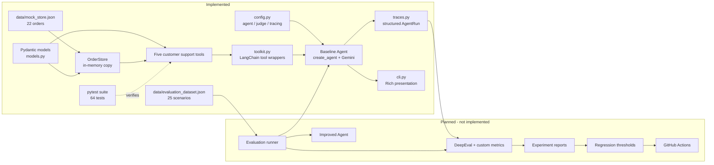

# Architecture

This document describes the verified implementation first, then the components that are planned. A component listed as planned does not exist in the repository yet.

## Current components

| Component | Location | Status | Responsibility |
| --- | --- | --- | --- |
| Mock store data | `data/mock_store.json` | Implemented | Fixed order records for the fictional electronics store. |
| Evaluation scenarios | `data/evaluation_dataset.json` | Implemented | Fixed, category-labeled scenarios with expected tool calls and qualitative expectations. |
| Data models | `src/agent/tools/models.py` | Implemented | Pydantic models for orders, tool results, and escalation records. |
| Data access | `src/agent/tools/store.py` | Implemented | Loads JSON, validates it, and serves an isolated in-memory order store. |
| Customer support tools | `src/agent/tools/customer_support_tools.py` | Implemented | Business rules for status, details, refund eligibility, cancellation, and escalation. |
| Tool unit tests | `tests/test_customer_support_tools.py` | Implemented | 38 pytest tests using temp data copies and injected dependencies. |
| Agent configuration | `src/agent/config.py` | Implemented | Loads `.env` and exposes independent agent, judge, and LangSmith settings as Pydantic models; secrets use `SecretStr`. |
| LangChain tool wrappers | `src/agent/toolkit.py` | Implemented | Adapts the five tools for LangChain and serializes their Pydantic results to JSON; delegates all business logic. |
| Structured execution traces | `src/agent/traces.py` | Implemented | Pydantic `ToolCallRecord`/`AgentRun` models and helpers that pair ordered tool calls with their results. |
| Baseline Agent | `src/agent/baseline_agent.py` | Implemented | LangChain `create_agent` graph over the tools with a Google Gemini model; records a structured trace per run. |
| CLI presentation | `src/agent/cli.py` | Implemented | Rich-based terminal rendering of tool calls and the final response; contains no agent logic. |
| Agent scaffolding tests | `tests/test_agent_scaffolding.py` | Implemented | 16 pytest tests for config, traces, tool wrappers, and agent wiring (no network). |
| Agent orchestration tests | `tests/test_baseline_agent.py` | Implemented | 8 pytest tests driving the agent with mocked models (no tool call, single call, multiple calls, result capture, streaming, API error, recursion limit). |
| CLI tests | `tests/test_cli.py` | Implemented | 2 pytest tests for run rendering and graceful error handling. |
| Evaluation runner | — | Planned | Runs scenarios, captures traces, applies metrics, and records results. |
| DeepEval and custom metrics | — | Planned | Answer-quality and behavior scoring. |
| Experiment reports | — | Planned | Baseline vs Improved results and failure analysis. |
| Regression testing / CI | — | Planned | Quality thresholds and automated checks in GitHub Actions. |

## Current and intended data flow

Mermaid diagram; components inside the shaded `Planned` group do not exist yet.

## Implemented data layer

### Mock store

`data/mock_store.json` contains the store name, currency (`USD`), schema version, and 22 orders. Each order has an ID, status, items (product, quantity, unit price), order date, optional delivery date, total, item condition, original-packaging flag, and optional notes.

Current status distribution: 4 `processing`, 3 `shipped`, 15 `delivered`. No `cancelled` order is stored on disk; cancellation adds that status only to an in-memory store.

The file is a read-only fixture. Nothing in the application writes to it.

### OrderStore

`OrderStore` in `store.py`:

- resolves the default path from the module location (`Path(__file__).resolve().parents[3] / "data" / "mock_store.json"`), so it does not depend on the current working directory;
- validates the document through `StoreData` and `Order` Pydantic models, including unique order IDs;
- keeps orders in a dictionary, separate from the raw JSON;
- exposes `get_order`, `list_orders`, and `set_order_status`;
- can be constructed with `data_path=` (for a temporary JSON copy) or `data=` (for an isolated in-memory fixture);
- never writes status changes back to disk.

`get_default_store()` lazily creates one process-wide store. Tests inject their own instance so cancellation does not leak between tests.

### Models

`models.py` defines:

- `OrderItem`, `Order`, and `StoreData` for source data;
- `OrderStatus` as a literal of `processing`, `shipped`, `delivered`, and `cancelled`;
- result models for each tool, all carrying `success` and a deterministic `message`;
- `EscalationRequest`, `EscalationRecord`, and `EscalationResult`.

Tool results include `order_id: str | None` because invalid input has no normalized ID.

## Implemented business logic

All five tools normalize order IDs by trimming whitespace and a leading `#`. Empty IDs and unknown orders return structured failures rather than raising for normal lookup misses. Each tool accepts keyword-only dependency injection for tests: `store=` and, for escalation, `registry=`.

| Tool | Behavior | Failure behavior |
| --- | --- | --- |
| `get_order_status` | Returns the current `OrderStatus`. | Empty ID or unknown order returns `success=False`. |
| `get_order_details` | Returns items, order date, delivery date, total, and currency. | Empty ID or unknown order returns `success=False` with empty items. |
| `check_refund_eligibility` | Evaluates the standard return rules; never processes or promises a refund. | Empty ID or unknown order returns `success=False`. |
| `cancel_order` | Cancels only `processing` orders, updates the in-memory status, then verifies the update before reporting success. | Non-processing status is rejected; unknown order returns `success=False`; failed update is not reported as success. |
| `escalate_to_human` | Creates an in-memory escalation record with or without an order ID. | Blank reason returns `success=False`. Unknown order IDs are intentionally allowed because an unverifiable order may still require a human. |

### Refund rule order

`check_refund_eligibility` applies checks in this order:

1. Unknown or empty ID: failure result.
2. Cancelled order: not eligible.
3. Not delivered or missing delivery date: not eligible.
4. Delivery date after the reference date: eligibility cannot be confirmed.
5. Human-support conditions: `item_condition == "damaged"`, notes containing `missing` or `tampered`, or `item_condition == "unknown"`. Returns `eligible=False`, `requires_human_support=True`, and never an ordinary approval.
6. More than 30 calendar days since delivery: not eligible.
7. Condition other than `unused`: not eligible.
8. `original_packaging == False`: not eligible.
9. Otherwise eligible, with a message stating that no refund was processed.

`reference_date` defaults to `date.today()` for real use. Tests pass a fixed date (`2026-11-24`) for determinism.

### Escalation registry

`EscalationRegistry` stores records in a Python list and generates sequential IDs such as `ESC-000001`. IDs and records are process-local and reset on restart. The module creates one default registry; tests use a fresh instance.

## Test architecture

`tests/test_customer_support_tools.py` covers:

- existing, unknown, empty, and normalized order IDs;
- `processing`, `shipped`, `delivered`, and post-cancellation `cancelled` statuses;
- successful cancellation and rejection for shipped, delivered, and already-cancelled orders;
- the 30-day boundary (day 30 eligible, day 31 not eligible);
- used items, damaged items, missing items, missing packaging, undelivered and cancelled orders;
- escalation with an order ID, without one, for an unverified order, and with a blank reason;
- isolation of in-memory changes and non-writing of the temp store file.

Fixtures create a temporary copy of `mock_store.json`. The real data file is never mutated.

## Implemented agent layer

The Baseline Agent is implemented with the modern LangChain `create_agent` API. It does not use the deprecated `AgentExecutor`/`initialize_agent`, a custom orchestration loop, or a hand-written graph.

### Configuration

`src/agent/config.py` loads `.env` with `python-dotenv` (`override=False`) and exposes three independent Pydantic models:

- `AgentSettings` — `GOOGLE_API_KEY`, `AGENT_MODEL`, optional `AGENT_TEMPERATURE`.
- `JudgeSettings` — `OPENROUTER_API_KEY`, `OPENROUTER_BASE_URL` (defaults to `https://openrouter.ai/api/v1`), `JUDGE_MODEL`. Prepared for the future judge; no judge code exists yet.
- `LangSmithSettings` — `LANGSMITH_TRACING`, `LANGSMITH_API_KEY`, `LANGSMITH_PROJECT`; `apply()` publishes these to the environment LangSmith reads.

Agent and judge settings are loaded by separate functions, so building the agent never requires judge credentials and vice versa. Secrets are held in `SecretStr` and are masked in `repr`, so they cannot leak into logs or traces. No model name or API key is hardcoded.

### Tool wrappers

`src/agent/toolkit.py` exposes `build_customer_support_tools`, which wraps the existing five tools with LangChain's `@tool` decorator. The wrappers only adapt the signatures (each takes the order ID, or an optional order ID and reason for escalation) and serialize the Pydantic results to JSON. Every call is delegated to `agent.tools.customer_support_tools`; no business rule is reimplemented. An optional `store`, `registry`, and `reference_date` are captured by closure and injected through the tools' keyword-only parameters, which lets the runner isolate state per scenario.

### Agent and traces

`src/agent/baseline_agent.py` builds a model with `ChatGoogleGenerativeAI` (Google AI Studio direct API) using `AgentSettings`, and compiles the graph with `create_agent(model=..., tools=..., system_prompt=...)`. The system prompt is intentionally minimal: it states the agent is a customer support assistant, lists the areas it helps with, tells it to use tools when needed and not to invent order information. It deliberately omits detailed business policies, decision trees, and evaluation-specific instructions, so the baseline's weaknesses are discoverable through evaluation. It contains no scenario IDs and no expected tool calls.

`BaselineAgent.run` invokes the graph once (with `invoke`) using a `RunnableConfig` that sets a recursion limit (`DEFAULT_RECURSION_LIMIT = 25`) so multi-call interactions terminate, and returns an `AgentRun` from `src/agent/traces.py`. The graph supports multiple tool calls in a single interaction and stops when the model produces a final answer.

The `AgentRun` records the run ID, the user message, the model name, the `answer` (final customer-facing response), the ordered `tool_calls`, and the serialized `messages`. Each `ToolCallRecord` has `tool_name`, `arguments`, `result` (or `error`), and `call_id`. `extract_tool_calls` pairs calls with their `ToolMessage` results by call ID, `extract_answer` returns the last assistant text (extracting text blocks from Gemini's content-block format), and `serialize_messages` produces a plain structured message list. Tool calls are read from the execution messages, never inferred from the final answer.

### LangSmith tracing

Tracing uses the single LangSmith project `agenteval` (from `LANGSMITH_PROJECT`). Baseline and future Improved agents share this project and are distinguished by tags and metadata rather than separate projects. `BaselineAgent.run_config` passes `tags=["baseline"]`, `metadata={"experiment": "baseline", "agent_version": 1}`, and `run_name="baseline-agent"` to the graph invocation, so LLM calls and tool executions are traced under those labels. No custom tracing callbacks are added and no extra LLM calls are made for tracing. Secrets are never logged.

### CLI

`src/agent/cli.py` is the manual-testing entry point, invoked with `PYTHONPATH=src uv run python -m agent.cli "<message>"` for a single run, or without a message for an interactive session that accepts messages until the user types `exit` or sends Ctrl-D. It uses Rich (`Console`, `Panel`, `Table`, `Status`):

- prints the application title panel (`AgentEval — Customer Support Agent`);
- shows a `Status` spinner with `Agent is thinking...` while the model is working, and keeps it visible during the actual streamed wait;
- consumes `BaselineAgent.stream(...)` and updates the status with each tool call and its arguments as they occur, then renders an ordered tool-call table and the answer in a distinct panel;
- catches agent and API errors and shows them in an error panel without crashing the loop.

Presentation stays separate from agent logic, and the core agent never prints to the terminal. The CLI calls the same `create_baseline_agent`/`BaselineAgent` used by the programmatic interface. It does not dump raw internal messages.

### Evaluation compatibility

The agent exposes everything the future runner needs without adding evaluation code: `create_baseline_agent(...)` creates an instance; `BaselineAgent.run(message)` submits a message and returns an `AgentRun`; `run.answer` is the final answer; `run.tool_calls` are the actual calls with `tool_name`, `arguments`, and `result`; and `run_config`/`create_baseline_agent(tags=..., metadata=...)` associate execution with an experiment version (`baseline`, `agent_version: 1`). A runner can also consume `BaselineAgent.stream(...)` for incremental events. No DeepEval, judge, metrics, database, or persistent conversation memory is implemented.

Isolation for scenario runs uses the existing data layer: `OrderStore` already supports an isolated copy via `OrderStore(data=...)` or `OrderStore(data_path=...)`, and never writes to disk. The runner must construct a fresh `OrderStore` and `EscalationRegistry` per scenario (cancellation and escalation mutate in-memory state) and pass a fixed `reference_date`. No data-layer change is required.

### Agent dependencies

`langchain`, `langchain-google-genai`, `langchain-openai` (for the future judge), `langsmith`, `rich`, and `python-dotenv` are runtime dependencies in `uv.lock`.

## Planned components

The following are requirements for later milestones, not current code.

### Evaluation runner

The runner will load `evaluation_dataset.json`, execute each scenario against an agent, isolate mutable state between scenarios (a fresh store is required because cancellation mutates it), save traces, and hand results to deterministic checks and DeepEval metrics. It should support selecting a run label such as baseline or improved without changing scenario content.

### DeepEval and metrics

DeepEval is not installed. It will provide LLM-as-a-judge metrics, while custom metrics and deterministic checks will cover tool selection, arguments, sequence, execution results, and escalation. See `docs/EVALUATION_STRATEGY.md`.

### Reports, regression, and CI

Experiment reports will summarize aggregate and per-scenario results, including failures and metric disagreements. Regression gates will compare against stored thresholds or a prior run. GitHub Actions will run unit tests and evaluation checks; no workflow exists yet.

## Boundaries that must survive later changes

- Agent execution stays independent of evaluation logic.
- Terminal presentation stays independent of agent decisions.
- Tool functions stay deterministic and free of LLM or network calls.
- Evaluation scenarios never become inputs to tool implementations or prompt branches.
- Structured traces are preserved, not collapsed into unstructured logs.
- Business rules and fixed data changes require explicit approval.

## Known limitations of the current stage

- The Baseline Agent exists but has not been evaluated; there are no Baseline or Improved results.
- The Baseline system prompt is intentionally minimal, so the baseline is expected to skip some required pre-checks (for example, calling `cancel_order` without first checking the status) and to miss escalation triggers; these weaknesses are what the evaluation is meant to reveal.
- The agent handles a single customer message per run; there is no multi-turn conversation state.
- Running the agent requires a Google API key and network access. Only the scaffolding is unit-tested offline; agent behavior is not.
- The judge is not implemented; `JudgeSettings` only prepares the OpenRouter configuration.
- Cancellation and escalation state are in-memory only and reset with the process.
- The default store and default registry are shared within a process, which is acceptable for local use but unsuitable for parallel scenario execution without isolated instances. The runner must pass a fresh store and registry per scenario.
- Refund eligibility depends on the current date unless `reference_date` is supplied.
- The test suite validates the tool layer and the offline agent scaffolding only; it says nothing about agent quality.