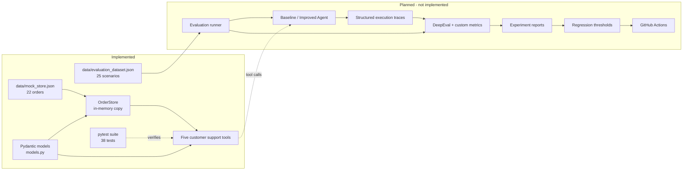

# Architecture

This document describes the verified implementation first, then the components that are planned. A component listed as planned does not exist in the repository yet.

## Current components

| Component | Location | Status | Responsibility |
| --- | --- | --- | --- |
| Mock store data | `data/mock_store.json` | Implemented | Fixed order records for the fictional electronics store. |
| Evaluation scenarios | `data/evaluation_dataset.json` | Implemented | Fixed, category-labeled scenarios with expected tool calls and qualitative expectations. |
| Data models | `src/agent/tools/models.py` | Implemented | Pydantic models for orders, tool results, and escalation records. |
| Data access | `src/agent/tools/store.py` | Implemented | Loads JSON, validates it, and serves an isolated in-memory order store. |
| Customer support tools | `src/agent/tools/customer_support_tools.py` | Implemented | Business rules for status, details, refund eligibility, cancellation, and escalation. |
| Tool unit tests | `tests/test_customer_support_tools.py` | Implemented | 38 pytest tests using temp data copies and injected dependencies. |
| Agent orchestration | — | Planned | Calls tools in response to a customer message and produces a response. |
| Structured execution traces | — | Planned | Preserves tool calls, arguments, results, sequence, and final output. |
| Evaluation runner | — | Planned | Runs scenarios, captures traces, applies metrics, and records results. |
| DeepEval and custom metrics | — | Planned | Answer-quality and behavior scoring. |
| Experiment reports | — | Planned | Baseline vs Improved results and failure analysis. |
| Regression testing / CI | — | Planned | Quality thresholds and automated checks in GitHub Actions. |

## Current and intended data flow

Mermaid diagram; components inside the shaded `Planned` group do not exist yet.

## Implemented data layer

### Mock store

`data/mock_store.json` contains the store name, currency (`USD`), schema version, and 22 orders. Each order has an ID, status, items (product, quantity, unit price), order date, optional delivery date, total, item condition, original-packaging flag, and optional notes.

Current status distribution: 4 `processing`, 3 `shipped`, 15 `delivered`. No `cancelled` order is stored on disk; cancellation adds that status only to an in-memory store.

The file is a read-only fixture. Nothing in the application writes to it.

### OrderStore

`OrderStore` in `store.py`:

- resolves the default path from the module location (`Path(__file__).resolve().parents[3] / "data" / "mock_store.json"`), so it does not depend on the current working directory;
- validates the document through `StoreData` and `Order` Pydantic models, including unique order IDs;
- keeps orders in a dictionary, separate from the raw JSON;
- exposes `get_order`, `list_orders`, and `set_order_status`;
- can be constructed with `data_path=` (for a temporary JSON copy) or `data=` (for an isolated in-memory fixture);
- never writes status changes back to disk.

`get_default_store()` lazily creates one process-wide store. Tests inject their own instance so cancellation does not leak between tests.

### Models

`models.py` defines:

- `OrderItem`, `Order`, and `StoreData` for source data;
- `OrderStatus` as a literal of `processing`, `shipped`, `delivered`, and `cancelled`;
- result models for each tool, all carrying `success` and a deterministic `message`;
- `EscalationRequest`, `EscalationRecord`, and `EscalationResult`.

Tool results include `order_id: str | None` because invalid input has no normalized ID.

## Implemented business logic

All five tools normalize order IDs by trimming whitespace and a leading `#`. Empty IDs and unknown orders return structured failures rather than raising for normal lookup misses. Each tool accepts keyword-only dependency injection for tests: `store=` and, for escalation, `registry=`.

| Tool | Behavior | Failure behavior |
| --- | --- | --- |
| `get_order_status` | Returns the current `OrderStatus`. | Empty ID or unknown order returns `success=False`. |
| `get_order_details` | Returns items, order date, delivery date, total, and currency. | Empty ID or unknown order returns `success=False` with empty items. |
| `check_refund_eligibility` | Evaluates the standard return rules; never processes or promises a refund. | Empty ID or unknown order returns `success=False`. |
| `cancel_order` | Cancels only `processing` orders, updates the in-memory status, then verifies the update before reporting success. | Non-processing status is rejected; unknown order returns `success=False`; failed update is not reported as success. |
| `escalate_to_human` | Creates an in-memory escalation record with or without an order ID. | Blank reason returns `success=False`. Unknown order IDs are intentionally allowed because an unverifiable order may still require a human. |

### Refund rule order

`check_refund_eligibility` applies checks in this order:

1. Unknown or empty ID: failure result.
2. Cancelled order: not eligible.
3. Not delivered or missing delivery date: not eligible.
4. Delivery date after the reference date: eligibility cannot be confirmed.
5. Human-support conditions: `item_condition == "damaged"`, notes containing `missing` or `tampered`, or `item_condition == "unknown"`. Returns `eligible=False`, `requires_human_support=True`, and never an ordinary approval.
6. More than 30 calendar days since delivery: not eligible.
7. Condition other than `unused`: not eligible.
8. `original_packaging == False`: not eligible.
9. Otherwise eligible, with a message stating that no refund was processed.

`reference_date` defaults to `date.today()` for real use. Tests pass a fixed date (`2026-11-24`) for determinism.

### Escalation registry

`EscalationRegistry` stores records in a Python list and generates sequential IDs such as `ESC-000001`. IDs and records are process-local and reset on restart. The module creates one default registry; tests use a fresh instance.

## Test architecture

`tests/test_customer_support_tools.py` covers:

- existing, unknown, empty, and normalized order IDs;
- `processing`, `shipped`, `delivered`, and post-cancellation `cancelled` statuses;
- successful cancellation and rejection for shipped, delivered, and already-cancelled orders;
- the 30-day boundary (day 30 eligible, day 31 not eligible);
- used items, damaged items, missing items, missing packaging, undelivered and cancelled orders;
- escalation with an order ID, without one, for an unverified order, and with a blank reason;
- isolation of in-memory changes and non-writing of the temp store file.

Fixtures create a temporary copy of `mock_store.json`. The real data file is never mutated.

## Planned components

The following are requirements for later milestones, not current code.

### Agent orchestration

A future agent module will accept a customer message, decide whether and which tools to call, supply arguments, consume structured results, and produce a customer-facing answer. It must use the existing tool interfaces rather than reimplementing business rules. Baseline and Improved agents will share the same tool layer and fixed dataset; their differences will be documented rather than hidden.

### Structured execution traces

The runner must capture each run as structured data, not free-text logs. The trace schema is not implemented. It needs to retain at least the scenario ID, user message, ordered tool calls with names and arguments, tool results or errors, the final response, and a run identifier. Trace timings and model metadata may be added later. Traces are the basis for behavior evaluation and failure investigation.

### Evaluation runner

The runner will load `evaluation_dataset.json`, execute each scenario against an agent, isolate mutable state between scenarios (a fresh store is required because cancellation mutates it), save traces, and hand results to deterministic checks and DeepEval metrics. It should support selecting a run label such as baseline or improved without changing scenario content.

### DeepEval and metrics

DeepEval is not installed. It will provide LLM-as-a-judge metrics, while custom metrics and deterministic checks will cover tool selection, arguments, sequence, execution results, and escalation. See `docs/EVALUATION_STRATEGY.md`.

### Reports, regression, and CI

Experiment reports will summarize aggregate and per-scenario results, including failures and metric disagreements. Regression gates will compare against stored thresholds or a prior run. GitHub Actions will run unit tests and evaluation checks; no workflow exists yet.

## Boundaries that must survive later changes

- Agent execution stays independent of evaluation logic.
- Terminal presentation stays independent of agent decisions.
- Tool functions stay deterministic and free of LLM or network calls.
- Evaluation scenarios never become inputs to tool implementations or prompt branches.
- Structured traces are preserved, not collapsed into unstructured logs.
- Business rules and fixed data changes require explicit approval.

## Known limitations of the current stage

- No agent, no tool-calling loop, and no prompts exist.
- No evaluation has been run; there are no Baseline or Improved results.
- Cancellation and escalation state are in-memory only and reset with the process.
- The default store and default registry are shared within a process, which is acceptable for local use but unsuitable for parallel scenario execution without isolated instances.
- Refund eligibility depends on the current date unless `reference_date` is supplied.
- The test suite validates the tool layer only; it says nothing about agent quality.