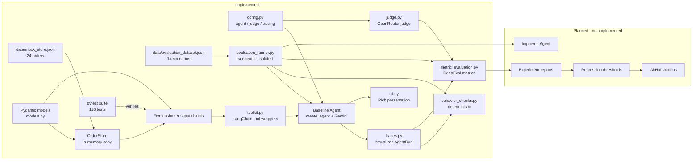

# Architecture

This document describes the verified implementation first, then the components that are planned. A component listed as planned does not exist in the repository yet.

## Current components

| Component | Location | Status | Responsibility |
| --- | --- | --- | --- |
| Mock store data | `data/mock_store.json` | Implemented | Fixed order records for the fictional electronics store. |
| Evaluation scenarios | `data/evaluation_dataset.json` | Implemented | Fixed, category-labeled scenarios with expected tool calls and qualitative expectations. |
| Data models | `src/agent/tools/models.py` | Implemented | Pydantic models for orders, tool results, and escalation records. |
| Data access | `src/agent/tools/store.py` | Implemented | Loads JSON, validates it, and serves an isolated in-memory order store. |
| Customer support tools | `src/agent/tools/customer_support_tools.py` | Implemented | Business rules for status, details, refund eligibility, cancellation, and escalation. |
| Tool unit tests | `tests/test_customer_support_tools.py` | Implemented | 38 pytest tests using temp data copies and injected dependencies. |
| Agent configuration | `src/agent/config.py` | Implemented | Loads `.env` and exposes independent agent, judge, and LangSmith settings as Pydantic models; secrets use `SecretStr`. |
| LangChain tool wrappers | `src/agent/toolkit.py` | Implemented | Adapts the five tools for LangChain and serializes their Pydantic results to JSON; delegates all business logic. |
| Structured execution traces | `src/agent/traces.py` | Implemented | Pydantic `ToolCallRecord`/`AgentRun` models and helpers that pair ordered tool calls with their results. |
| Baseline Agent | `src/agent/baseline_agent.py` | Implemented | LangChain `create_agent` graph over the tools with a Google Gemini model; records a structured trace per run. |
| CLI presentation | `src/agent/cli.py` | Implemented | Rich-based terminal rendering of tool calls and the final response; contains no agent logic. |
| Agent scaffolding tests | `tests/test_agent_scaffolding.py` | Implemented | 20 pytest tests for config, traces, tool wrappers, agent wiring, refund/escalation rules, and metadata (no network). |
| Agent orchestration tests | `tests/test_baseline_agent.py` | Implemented | 8 pytest tests driving the agent with mocked models (no tool call, single call, multiple calls, result capture, streaming, API error, recursion limit). |
| CLI tests | `tests/test_cli.py` | Implemented | 2 pytest tests for run rendering and graceful error handling. |
| Scenario loader | `src/agent/scenarios.py` | Implemented | Reads and validates `data/evaluation_dataset.json`; never writes to it. |
| Behavior checks | `src/agent/behavior_checks.py` | Implemented | Deterministic checks for expected tool calls, arguments, escalation, and the cancellation precondition; judge checks are appended when a judge is provided. |
| Judge checks | `src/agent/judge_checks.py` | Implemented | LLM-judge checks for `expected_facts` and `forbidden_behaviors` via the shared OpenRouter judge; pass/fail/error. |
| Evaluation runner | `src/agent/evaluation_runner.py` | Implemented | Runs scenarios sequentially with an isolated store per scenario, runs checks, saves results incrementally, and summarizes. |
| Evaluation tests | `tests/test_evaluation_runner.py` | Implemented | 38 pytest tests for the loader, checks, isolation, incremental saving, error handling, resume, single-scenario rerun, timeout, progress, scenario metadata, judge checks, cancellation precondition, metric integration, metric summary counts, and CLI validation (mocked agent/judge, no network). |
| Judge-check tests | `tests/test_judge_checks.py` | Implemented | 11 pytest tests for expected-fact and forbidden-behavior judging and deterministic-fact filtering (fake judge, no API calls). |
| Judge model | `src/agent/judge.py` | Implemented | OpenRouter-backed DeepEval judge (Groq model via OpenRouter), built from `JudgeSettings`. |
| DeepEval metrics | `src/agent/metric_evaluation.py` | Implemented | Answer Relevancy, Faithfulness, Contextual Precision, Contextual Recall over each scenario's answer and tool-result evidence. |
| Metric tests | `tests/test_metric_evaluation.py` | Implemented | 10 pytest tests for evidence mapping and metric scoring/error handling with fake metrics (no API calls). |
| Custom metric tests | `tests/test_custom_metrics.py` | Implemented | 14 pytest tests for Tool Outcome Consistency and Business Policy Compliance pass/fail/error paths and runner integration (fake judge, no API calls). |
| Experiment reports | — | Planned | Baseline vs Improved results and failure analysis. |
| Regression testing / CI | — | Planned | Quality thresholds and automated checks in GitHub Actions. |

## Current and intended data flow

Mermaid diagram; components inside the shaded `Planned` group do not exist yet.

## Implemented data layer

### Mock store

`data/mock_store.json` contains the store name, currency (`USD`), schema version, and 24 orders. Each order has an ID, status, items (product, quantity, unit price), order date, optional delivery date, total, item condition, original-packaging flag, and optional notes.

Current status distribution: 4 `processing`, 3 `shipped`, 15 `delivered`. No `cancelled` order is stored on disk; cancellation adds that status only to an in-memory store.

The file is a read-only fixture. Nothing in the application writes to it.

### OrderStore

`OrderStore` in `store.py`:

- resolves the default path from the module location (`Path(__file__).resolve().parents[3] / "data" / "mock_store.json"`), so it does not depend on the current working directory;
- validates the document through `StoreData` and `Order` Pydantic models, including unique order IDs;
- keeps orders in a dictionary, separate from the raw JSON;
- exposes `get_order`, `list_orders`, and `set_order_status`;
- can be constructed with `data_path=` (for a temporary JSON copy) or `data=` (for an isolated in-memory fixture);
- never writes status changes back to disk.

`get_default_store()` lazily creates one process-wide store. Tests inject their own instance so cancellation does not leak between tests.

### Models

`models.py` defines:

- `OrderItem`, `Order`, and `StoreData` for source data;
- `OrderStatus` as a literal of `processing`, `shipped`, `delivered`, and `cancelled`;
- result models for each tool, all carrying `success` and a deterministic `message`;
- `EscalationRequest`, `EscalationRecord`, and `EscalationResult`.

Tool results include `order_id: str | None` because invalid input has no normalized ID.

## Implemented business logic

All five tools normalize order IDs by trimming whitespace and a leading `#`. Empty IDs and unknown orders return structured failures rather than raising for normal lookup misses. Each tool accepts keyword-only dependency injection for tests: `store=` and, for escalation, `registry=`.

| Tool | Behavior | Failure behavior |
| --- | --- | --- |
| `get_order_status` | Returns the current `OrderStatus`. | Empty ID or unknown order returns `success=False`. |
| `get_order_details` | Returns items, order date, delivery date, total, and currency. | Empty ID or unknown order returns `success=False` with empty items. |
| `check_refund_eligibility` | Evaluates the standard return rules; never processes or promises a refund. | Empty ID or unknown order returns `success=False`. |
| `cancel_order` | Cancels only `processing` orders, updates the in-memory status, then verifies the update before reporting success. | Non-processing status is rejected; unknown order returns `success=False`; failed update is not reported as success. |
| `escalate_to_human` | Creates an in-memory escalation record with or without an order ID. | Blank reason returns `success=False`. Unknown order IDs are intentionally allowed because an unverifiable order may still require a human. |

### Refund rule order

`check_refund_eligibility` applies checks in this order:

1. Unknown or empty ID: failure result.
2. Cancelled order: not eligible.
3. Not delivered or missing delivery date: not eligible.
4. Delivery date after the reference date: eligibility cannot be confirmed.
5. Human-support conditions: `item_condition == "damaged"`, notes containing `missing` or `tampered`, or `item_condition == "unknown"`. Returns `eligible=False`, `requires_human_support=True`, and never an ordinary approval.
6. More than 30 calendar days since delivery: not eligible.
7. Condition other than `unused`: not eligible.
8. `original_packaging == False`: not eligible.
9. Otherwise eligible, with a message stating that no refund was processed.

`reference_date` defaults to `date.today()` for real use. Tests pass a fixed date (`2026-11-24`) for determinism.

### Escalation registry

`EscalationRegistry` stores records in a Python list and generates sequential IDs such as `ESC-000001`. IDs and records are process-local and reset on restart. The module creates one default registry; tests use a fresh instance.

## Test architecture

`tests/test_customer_support_tools.py` covers:

- existing, unknown, empty, and normalized order IDs;
- `processing`, `shipped`, `delivered`, and post-cancellation `cancelled` statuses;
- successful cancellation and rejection for shipped, delivered, and already-cancelled orders;
- the 30-day boundary (day 30 eligible, day 31 not eligible);
- used items, damaged items, missing items, missing packaging, undelivered and cancelled orders;
- escalation with an order ID, without one, for an unverified order, and with a blank reason;
- isolation of in-memory changes and non-writing of the temp store file.

Fixtures create a temporary copy of `mock_store.json`. The real data file is never mutated.

## Implemented agent layer

The Baseline Agent is implemented with the modern LangChain `create_agent` API. It does not use the deprecated `AgentExecutor`/`initialize_agent`, a custom orchestration loop, or a hand-written graph.

### Configuration

`src/agent/config.py` loads `.env` with `python-dotenv` (`override=False`) and exposes three independent Pydantic models:

- `AgentSettings` — `GOOGLE_API_KEY`, `AGENT_MODEL`, optional `AGENT_TEMPERATURE`.
- `JudgeSettings` — `OPENROUTER_API_KEY`, `OPENROUTER_BASE_URL` (defaults to `https://openrouter.ai/api/v1`), `JUDGE_MODEL`. Prepared for the future judge; no judge code exists yet.
- `LangSmithSettings` — `LANGSMITH_TRACING`, `LANGSMITH_API_KEY`, `LANGSMITH_PROJECT`; `apply()` publishes these to the environment LangSmith reads.

Agent and judge settings are loaded by separate functions, so building the agent never requires judge credentials and vice versa. Secrets are held in `SecretStr` and are masked in `repr`, so they cannot leak into logs or traces. No model name or API key is hardcoded.

### Tool wrappers

`src/agent/toolkit.py` exposes `build_customer_support_tools`, which wraps the existing five tools with LangChain's `@tool` decorator. The wrappers only adapt the signatures (each takes the order ID, or an optional order ID and reason for escalation) and serialize the Pydantic results to JSON. Every call is delegated to `agent.tools.customer_support_tools`; no business rule is reimplemented. An optional `store`, `registry`, and `reference_date` are captured by closure and injected through the tools' keyword-only parameters, which lets the runner isolate state per scenario.

### Agent and traces

`src/agent/baseline_agent.py` builds a model with `ChatGoogleGenerativeAI` (Google AI Studio direct API) using `AgentSettings`, and compiles the graph with `create_agent(model=..., tools=..., system_prompt=...)`. The system prompt is intentionally minimal except for a refund policy and an escalation policy: it states the agent is a customer support assistant, lists the areas it helps with, tells it to use tools when needed and not to invent order information; after a successful eligibility check it explains eligibility and never claims a refund was processed or offers to process one (no refund-processing tool exists); and it instructs the agent to call `escalate_to_human` (not merely offer it) for: an order not found after checking the order ID, a delivery delay with explicit urgency or an unmet deadline, damaged/missing/tampered/unverifiable items, a request for a human, or a repeated unresolved complaint. It omits other detailed business policies and decision trees, and contains no scenario IDs and no expected tool calls.

`BaselineAgent.run` invokes the graph once (with `invoke`) using a `RunnableConfig` that sets a recursion limit (`DEFAULT_RECURSION_LIMIT = 25`) so multi-call interactions terminate, and returns an `AgentRun` from `src/agent/traces.py`. The graph supports multiple tool calls in a single interaction and stops when the model produces a final answer.

The `AgentRun` records the run ID, the user message, the model name, the `answer` (final customer-facing response), the ordered `tool_calls`, and the serialized `messages`. Each `ToolCallRecord` has `tool_name`, `arguments`, `result` (or `error`), and `call_id`. `extract_tool_calls` pairs calls with their `ToolMessage` results by call ID, `extract_answer` returns the last assistant text (extracting text blocks from Gemini's content-block format), and `serialize_messages` produces a plain structured message list. Tool calls are read from the execution messages, never inferred from the final answer.

### LangSmith tracing

Tracing uses the single LangSmith project `agenteval` (from `LANGSMITH_PROJECT`). Baseline and future Improved agents share this project and are distinguished by tags and metadata rather than separate projects. `BaselineAgent.run_config` passes `tags=["baseline"]`, `metadata={"experiment": "baseline", "agent_version": 1}`, and `run_name="baseline-agent"` to the graph invocation, so LLM calls and tool executions are traced under those labels. Custom metadata is merged with those defaults, and the evaluation runner adds `scenario_id` and `scenario_category` so each scenario's trace is identifiable in LangSmith. No custom tracing callbacks are added and no extra LLM calls are made for tracing. Secrets are never logged.

### CLI

`src/agent/cli.py` is the manual-testing entry point, invoked with `PYTHONPATH=src uv run python -m agent.cli "<message>"` for a single run, or without a message for an interactive session that accepts messages until the user types `exit` or sends Ctrl-D. It uses Rich (`Console`, `Panel`, `Table`, `Status`):

- prints the application title panel (`AgentEval — Customer Support Agent`);
- shows a `Status` spinner with `Agent is thinking...` while the model is working, and keeps it visible during the actual streamed wait;
- consumes `BaselineAgent.stream(...)` and updates the status with each tool call and its arguments as they occur, then renders an ordered tool-call table and the answer in a distinct panel;
- catches agent and API errors and shows them in an error panel without crashing the loop.

Presentation stays separate from agent logic, and the core agent never prints to the terminal. The CLI calls the same `create_baseline_agent`/`BaselineAgent` used by the programmatic interface. It does not dump raw internal messages.

### Evaluation compatibility

The agent exposes everything the evaluation runner needs without adding evaluation code: `create_baseline_agent(...)` creates an instance; `BaselineAgent.run(message)` submits a message and returns an `AgentRun`; `run.answer` is the final answer; `run.tool_calls` are the actual calls with `tool_name`, `arguments`, and `result`; and `run_config`/`create_baseline_agent(tags=..., metadata=...)` associate execution with an experiment version (`baseline`, `agent_version: 1`). The runner can also consume `BaselineAgent.stream(...)` for incremental events. No DeepEval, judge, metrics, database, or persistent conversation memory is implemented.

Isolation for scenario runs uses the existing data layer: `OrderStore` already supports an isolated copy via `OrderStore(data=...)` or `OrderStore(data_path=...)`, and never writes to disk. The runner must construct a fresh `OrderStore` and `EscalationRegistry` per scenario (cancellation and escalation mutate in-memory state) and pass a fixed `reference_date`. No data-layer change is required.

### Evaluation runner

`src/agent/evaluation_runner.py` implements the first baseline evaluation experiment. It is separate from both the agent and the CLI.

- **Dataset:** `src/agent/scenarios.py` loads and validates `data/evaluation_dataset.json` with Pydantic models; the dataset is treated as read-only and its content is never hardcoded.
- **Execution:** scenarios run sequentially. For each scenario the runner builds a fresh agent through the existing `create_baseline_agent(...)` and calls `BaselineAgent.run(...)`; no agent logic is duplicated.
- **Isolation:** each scenario gets a new `OrderStore(data=deepcopy(store))` and a new `EscalationRegistry()`, plus a fixed `reference_date` (default `2026-11-24`). Because `cancel_order` and escalation mutate in-memory state, this guarantees one scenario cannot affect the next. No data-layer change was needed.
- **Collection:** each `ScenarioResult` records the scenario ID, category, customer message, the agent model (`agent_model`), final `answer`, actual `tool_calls` (name, arguments, result, error), deterministic `checks`, execution `status`, any `error`, and the scenario `duration_ms`.
- **Deterministic checks:** `src/agent/behavior_checks.py` verifies expected tool calls (presence and order), rejects calls to tools named in `forbidden_behaviors` (a tool in `expected_tool_calls` is never treated as forbidden), checks order-ID arguments, checks escalation expectations, and checks the cancellation precondition (any `cancel_order` must be preceded by a `get_order_status` that returned `processing`). Semantic `expected_facts` and the remaining forbidden behaviors are judged by the LLM judge (`src/agent/judge_checks.py`), which returns `pass`, `fail`, or `error` with an explanation; facts already covered by deterministic checks are not sent to the judge. A judge failure is recorded as `error`, not `deferred`, and never stops the scenario or the run. When no judge is supplied (for example `--no-metrics`), only the deterministic checks run.
- **Incremental saving:** every scenario result is appended immediately as one JSON line to `results/<label>_<run_id>.jsonl`, so an interrupted or rate-limited run keeps completed scenarios. Errors (including API/rate-limit failures) are caught per scenario, recorded with `status="error"`, and execution continues.
- **Resume:** `--resume <results.jsonl>` continues an interrupted run from its existing file. Completed scenarios (`status="ok"`) are skipped, errored scenarios are retried, new results are appended to the same file, the existing summary file is refreshed, and the original label and run ID are preserved. No new results file is created.
- **Single-scenario rerun:** `--scenario-id <id> --resume <results.jsonl>` runs only that scenario and replaces its existing record in place. The scenario must belong to the dataset and must already have a record in the run; unknown IDs and missing records are user-facing errors. The JSONL file is rewritten atomically so no duplicate records remain, all other records are byte-for-byte unchanged, the original label and run ID are preserved, and the summary is recalculated from the complete updated result set. Errored or timed-out records can be replaced by successful reruns.
- **Per-scenario timeout:** each scenario has a timeout (default 60s, `--timeout`). On POSIX main-thread execution a `SIGALRM` timer raises inside the blocking call, so the wait is genuinely interrupted and no worker is left running; the scenario is recorded as `status="error"` and the run continues. A thread-based fallback is used where signals are unavailable.
- **Progress output:** the CLI prints `[i/N] running <scenario id> (<category>) ...` before each scenario and a `done` (status, tool-call count) or `error` line after it, so a long run never appears frozen. The runner itself stays presentation-free and only calls optional `on_start`/`on_result` hooks.
- **Summary:** a `results/<label>_<run_id>.summary.json` file reports totals, successful/failed executions, check and metric pass/fail/error counts, and per-category totals.
- **Entry point:** `uv run eval-runner [--label baseline] [--dataset PATH] [--results-dir DIR] [--reference-date YYYY-MM-DD] [--limit N] [--timeout SECONDS] [--resume RESULTS_JSONL] [--scenario-id SCENARIO_ID]`. `--scenario-id` requires `--resume`.

The runner has not yet been executed against Gemini; that is the next milestone and awaits explicit approval.

### DeepEval metrics

`src/agent/metric_evaluation.py` adds six DeepEval metrics per scenario, run inside the existing runner after the deterministic checks:

- Standard metrics: **Answer Relevancy**, **Faithfulness**, **Contextual Precision**, **Contextual Recall**.
- Custom metrics in `src/agent/custom_metrics.py`: **Tool Outcome Consistency** and **Business Policy Compliance**.

Evidence mapping (there is no retrieval layer, so the agent's own tool results are the evidence):

- `input` = the scenario customer message;
- `actual_output` = the agent's final `answer`;
- `retrieval_context` = the agent's tool results (`"<tool>: <result json>"` per call);
- `expected_output` = the scenario `expected_facts` joined by newlines (`None` when empty);
- `metadata` = the serialized scenario and agent run, used by the custom metrics.

The custom metrics extend `deepeval.metrics.BaseMetric` and reuse the same OpenRouter judge. **Tool Outcome Consistency** asks the judge whether the final answer makes claims unsupported by the tool results (completed refunds, cancellations, escalation follow-ups, or resolution times). **Business Policy Compliance** asks the judge whether the answer complies with the store policy text in `custom_metrics.STORE_POLICY` (refund eligibility, privacy, and unsupported guarantees). Both metrics score 1.0/0.0 with a 0.5 threshold, record `score`, `reason`, `success`, and `name`, and convert judge or evidence errors into a metric `error` that never passes.

The judge is a separate model, never the Gemini agent: `src/agent/judge.py` defines `OpenRouterJudge`, a `DeepEvalBaseLLM` wrapping `langchain_openai.ChatOpenAI` pointed at `OPENROUTER_BASE_URL` with `OPENROUTER_API_KEY` and `JUDGE_MODEL`. Structured output is used when a metric requests a Pydantic schema. `build_metrics(judge)` instantiates the six metrics bound to that judge.

Each metric runs via `metric.measure(test_case)`. A failing metric (API error, rate limit, or missing `expected_output`) is recorded as a `MetricScore` with an `error` and never stops the scenario or the run. Scores and errors are stored in `ScenarioResult.metrics` and therefore in the JSONL results. Metrics run sequentially like the runner, are enabled by default, and are controlled with `--no-metrics` and `--limit`.

### Agent dependencies

`langchain`, `langchain-google-genai`, `langchain-openai` (agent + OpenRouter judge), `langsmith`, `rich`, `python-dotenv`, and `deepeval` are runtime dependencies in `uv.lock`. `rich` is pinned below 15 because DeepEval 4.x requires `rich<15`; the CLI uses only `Console`, `Panel`, `Table`, and `Status`, which Rich 14 provides.

## Planned components

The following are requirements for later milestones, not current code.

### Reports, regression, and CI

Experiment reports will summarize aggregate and per-scenario results, including failures and metric disagreements. Regression gates will compare against stored thresholds or a prior run. GitHub Actions will run unit tests and evaluation checks; no workflow exists yet.

## Boundaries that must survive later changes

- Agent execution stays independent of evaluation logic.
- Terminal presentation stays independent of agent decisions.
- Tool functions stay deterministic and free of LLM or network calls.
- Evaluation scenarios never become inputs to tool implementations or prompt branches.
- Structured traces are preserved, not collapsed into unstructured logs.
- Business rules and fixed data changes require explicit approval.

## Known limitations of the current stage

- The Baseline Agent exists and the runner is implemented, but no baseline experiment has been run against Gemini yet; there are no Baseline or Improved results.
- The Baseline system prompt is intentionally minimal apart from the escalation policy, so the baseline is still expected to skip some required pre-checks (for example, calling `cancel_order` without first checking the status); these weaknesses are what the evaluation is meant to reveal. Escalation is now explicitly specified in the prompt and the `escalate_to_human` description.
- `expected_facts` and forbidden behaviors that do not name a specific tool are scored by the LLM judge (`judge_checks`), not by the Python checks; forbidden tool calls named in the scenario text are also caught deterministically. Judge checks require the OpenRouter judge and are skipped (not failed) when it is not configured.
- The agent handles a single customer message per run; there is no multi-turn conversation state.
- Running the agent requires a Google API key and network access. Running metrics additionally requires an OpenRouter key and judge model. The unit tests mock both the agent model and the metrics and make no API calls.
- `expected_output` for the contextual metrics is derived from `expected_facts` (joined); scenarios without expected facts yield `None` and their Contextual Precision/Recall metrics record an error instead of a score.
- The DeepEval metrics have not been run against the real judge yet.
- Cancellation and escalation state are in-memory only and reset with the process.
- The runner creates a fresh `OrderStore` and `EscalationRegistry` per scenario, so scenarios are isolated; the agent's process-wide defaults are not used for evaluation.
- Refund eligibility depends on `reference_date`; the runner fixes it to `2026-11-24` by default.
- The test suite validates the tool layer, the offline agent scaffolding, the runner mechanics, and the metric plumbing with fakes; it says nothing about agent quality.